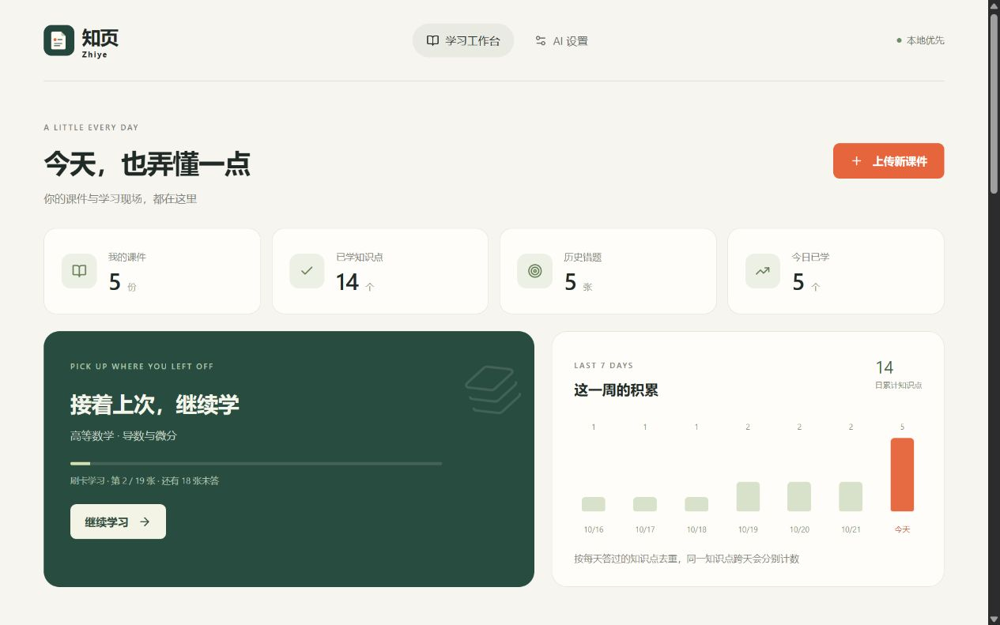
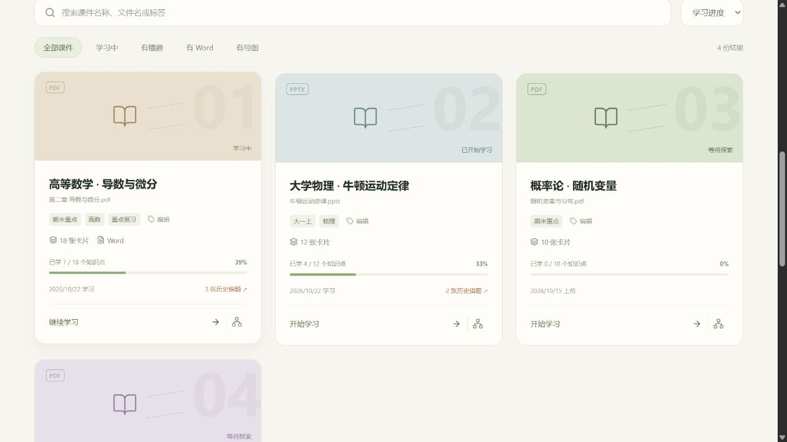
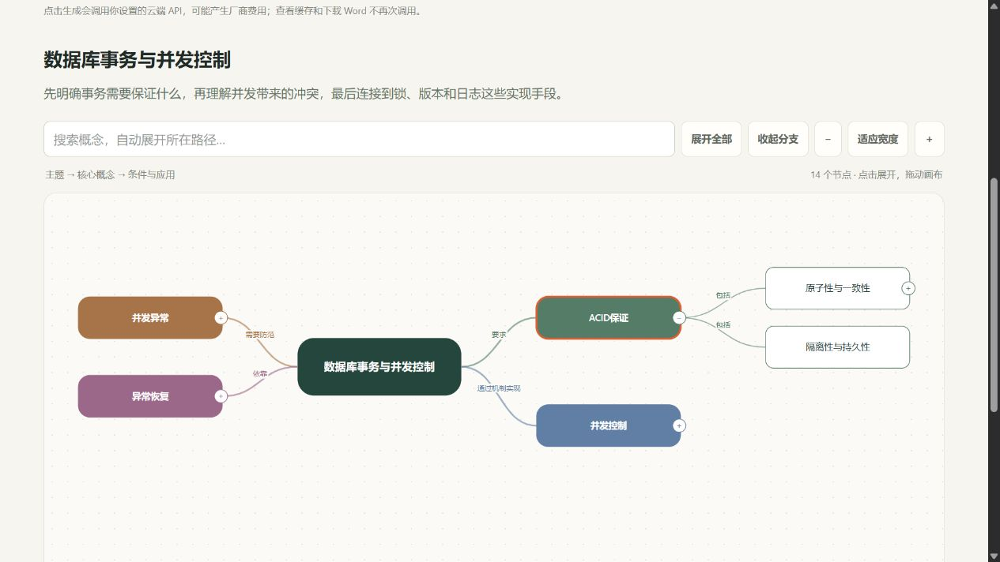
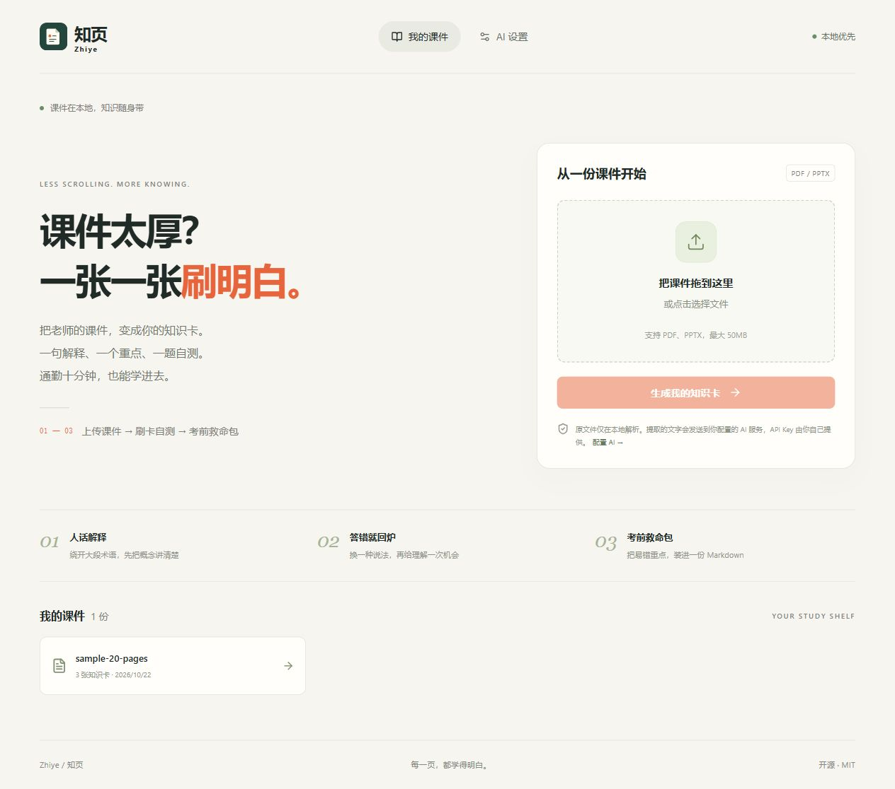
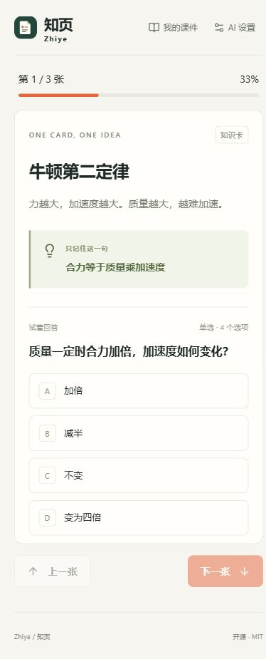
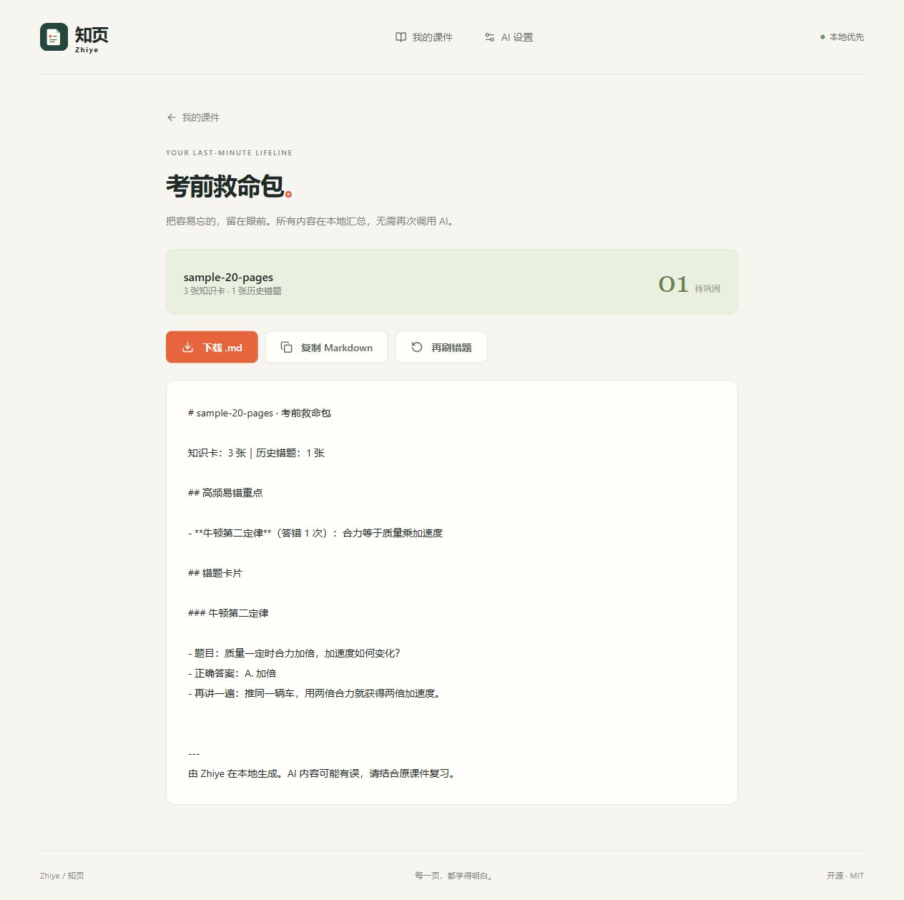
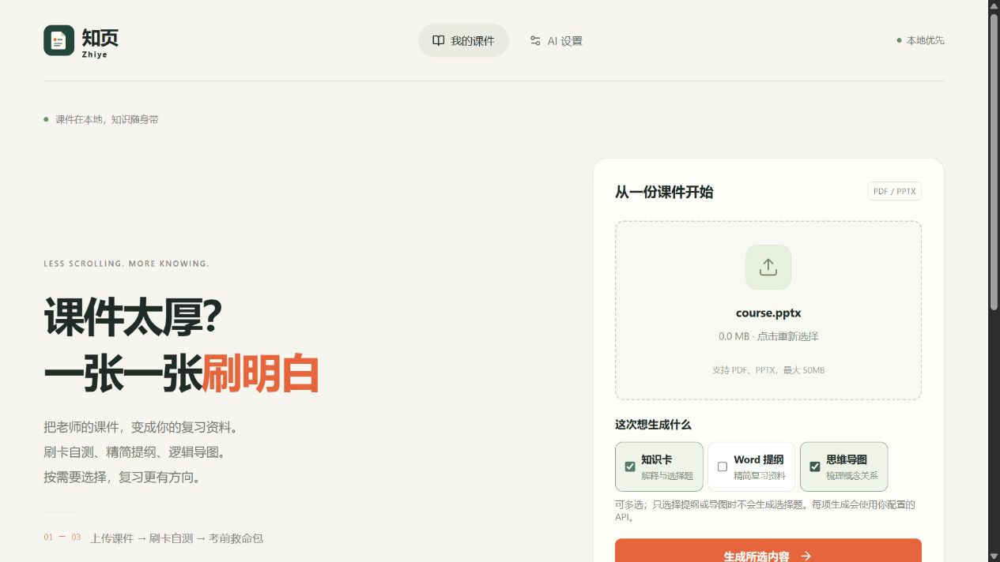
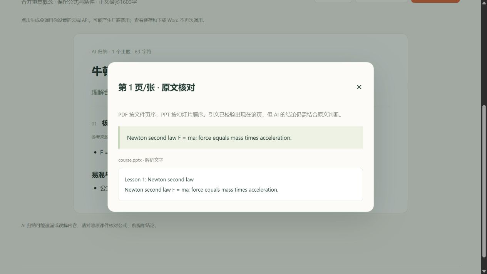

# Zhiye · 知页

[GitHub 仓库](https://github.com/Ace0721/zhiye) · [桌面安装包 Releases](https://github.com/Ace0721/zhiye/releases) · [构建状态](https://github.com/Ace0721/zhiye/actions)

**每一页，都学得明白。**

上传老师的 PDF / PPTX，AI 按原顺序拆成竖屏知识卡。一句人话解释、一个重点、一题自测；答错自动回炉，最后导出 Word「考前救命包」。

拆卡先筛选学习价值：课程学时、章节安排、考勤、成绩占比等事务信息不出题；保留定义、原理、公式、易混点与解题方法。旧卡组不会自动重写，升级后重新上传可应用新规则。

「考前救命包」根据个人答题记录按错误次数整理薄弱点、错题正确答案和补充解释，直接下载可编辑的 `.docx`，不额外调用 AI；没有错题时提供全课重点速记。页面提供正常排版预览，无需使用 Markdown。

## 学习工作台与课件库

- 首页显示继续学习、课件总数、已学知识点、历史错题与最近7天学习记录，数据来自本机答题记录；已学按答过的知识点去重，不表示已经掌握。历史错题包含后来答对的卡片，和错题本口径一致。
- 刷卡位置、每次已选答案、错题回炉队列和本轮完成状态保存到 SQLite。刷新页面、关闭应用或重启后都能继续；普通学习和错题复习分别保存现场。完成后可明确选择「重新学习」，历史答题记录保留。
- 答题和学习现场在同一事务保存。网络断开时显示错误与重新载入入口，已提交成功的答案不会因重复请求再次计数；多个窗口进度冲突会要求重新载入。
- 课件库支持标题、原文件名、标签搜索，以及最近学习、最新上传、名称、学习进度排序；可筛选学习中、有错题、有Word、有导图。标签存本机，最多6个，每个16字。
- 旧版本的答题记录会纳入首页统计，但无法推断此前停在哪张卡；升级后开始的新一轮学习才保存完整现场。卡片删除后自动修复队列，题目修改后重置对应现场答案，标题或解释润色保留答案。




以上使用独立验收数据库与示例学习记录，不是用户真实课件或学习数据。

## Word 复习资料和互动思维导图

上传时可勾选 **知识卡 / Word 资料 / 互动导图**，单选或多选均可；只选资料或导图时不会生成选择题。之后也可从课件工作台补充生成其他内容，不用先完成刷题。

- **AI 精简提纲**：使用独立提示词调用配置的 API，合并重复概念，按最多6个主题提炼核心结论、公式条件与易混区别，目标800～1200字、硬上限1600字符，不再拼接卡片或重复解释。生成后可预览和下载可编辑的 `.docx`。
- 提纲或导图格式不合规时，显示具体字段、位置与篇幅要求，并带上原结果自动纠错一次；仍失败才提示重新生成。正文保持1600字符上限，JSON和简短来源引文另计输出额度。
- **逻辑思维导图**：独立调用 API 归纳「主题 → 核心概念 → 条件与应用」，边上标明实际父子关系。中心向两侧展开，主题独立配色，支持搜索自动展开路径、缩放、折叠、拖动画布和详情查看。
- 上传时按勾选内容调用云端 API，工作台也可点击「开始 AI 生成」补充内容，可能产生厂商费用；两种内容分别保存到 SQLite，打开缓存与下载 Word 不再次调用。重新生成会替换对应结果。任务进度持久化，重启会标记未完成任务失败并允许重试。
- 新上传课件会将解析正文保留在本地 SQLite，用于独立整理；旧课件没有正文时会明确提示以已有知识点为资料，也可重新上传。长正文分批归纳后再整合，不直接截断末尾。原始文件仍在解析后删除。



导图与提纲截图使用结构化验收示例数据，只展示交互与布局，不代表真实模型的生成质量。

本地优先、MIT 开源。无需账号、Redis、向量数据库或本地模型。云端 AI 使用用户自己的 OpenAI 兼容 API 配置。



<details><summary>手机刷卡与考前救命包</summary>




</details>

> 30 秒 GIF 占位：后续在 `docs/demo.gif` 添加「上传 → 真实进度 → 答错回炉 → 导出」录屏。当前截图来自本地模拟 AI 的验收环境，示例不代表真实模型的质量或速度。

## 修改内容与核对来源

- 知识卡可编辑、删除或仅重新生成当前一张。手动编辑不调用 API，重新生成需要 API；题目、选项或正确答案变化时会清除这张卡的旧答题记录。
- Word 精简提纲可修改标题、主题和要点；导图可修改节点名称、关系和说明，也可删除节点。修改保存到本地，后续下载 Word 使用新内容。
- 新生成的卡片、提纲和导图可显示「第 N 页/张」来源按钮，打开原文摘录与本地保存的页面文字。服务端仅保留页码存在且引文可在原文匹配的引用；没有可靠引用时不猜页码。引用存在不等于 AI 结论一定正确。
- 旧卡组可继续使用；旧数据缺少来源时需要重新上传才能补齐。来源显示的是 PDF 物理页码或 PPT 幻灯片顺序，暂不提供原始版面预览。
- 编辑使用版本检查；重新生成期间有人手动修改，不会用稍后返回的 AI 结果覆盖修改。




上述截图使用本地模拟 API 的示例数据，仅展示功能。

## 数据去向

- 原始课件仅在本机临时保存和解析，解析结束后删除；暂不支持扫描件 OCR。
- **提取的课件文字会发送到你配置的云端 API**。本地优先不代表离线 AI。
- 解析正文、卡片、AI 复习结果、答题、任务和配置存入本地 SQLite。密钥不写日志，GET 设置仅返回是否已配置；密钥目前保存在本地 SQLite 中，请保护数据目录。
- 项目不内置密钥、不依赖项目方的付费云服务。你选择的 AI 厂商可能按其规则收费。

## Docker：一条命令启动

安装并启动 Docker Desktop 或 Docker Engine + Compose，在仓库根目录执行：

```sh
docker compose up --build -d
```

打开 [http://localhost:8080](http://localhost:8080)，进入 **AI 设置**，填写 `base_url`、`api_key`、`model`，测试连接并保存，再上传课件。

前端仅发布到本机回环地址，通过 Nginx 同源代理 `/api`。SQLite 持久化在宿主机 `./data`，后端端口不对宿主机暴露。可复制 `.env.example` 为 `.env` 配置端口、数据路径和 AI 默认值，也可不创建 `.env`、直接使用设置页。不要提交 `.env`。

```sh
docker compose logs -f
docker compose down
```

端口被占用时，在 `.env` 中设 `ZHIYE_WEB_PORT=18080` 后启动，访问 `http://localhost:18080`。请选本机空闲端口。变更环境后执行 `docker compose up -d --force-recreate`。停止容器不会删除宿主机数据。

首次构建需要下载镜像和依赖。Docker Hub 不可达时可使用可访问的镜像源；本地验收曾通过 [Google 的 Docker Hub 缓存](https://docs.cloud.google.com/artifact-registry/docs/pull-cached-dockerhub-images)预拉取官方镜像并打上原标签。Dockerfile 保持官方默认镜像。

## 下载安装

桌面使用 **Tauri 2 + PyInstaller 单文件后端**。目标产物为 Windows x64 `.msi`、macOS Apple Silicon / Intel `.dmg`。

发布者推送 `v*` 标签后，GitHub Actions 会在各平台构建安装包并上传到仓库 Releases。下载对应系统和架构的包，安装后在 **AI 设置**自行填写密钥。无需预装 Python 或 Node；Windows 缺少 WebView2 时安装器会自动下载运行时。

在 **[Releases 下载页](https://github.com/Ace0721/zhiye/releases)** 选择最新已发布版本，当前源码版本为 v0.5.1，实测状态见 [验收记录](docs/verification.md)。未签名包可能受到系统提示，正式分发可在 CI 增加平台签名与 macOS 公证。

| 系统 | 安装包 |
| --- | --- |
| Windows x64 | Releases 中的 `Zhiye_版本_x64_en-US.msi` |
| macOS Apple Silicon | Releases 中的 `Zhiye_版本_aarch64.dmg` |
| macOS Intel | Releases 中的 `Zhiye_版本_x64.dmg` |

Windows MSI、Apple Silicon 和 Intel Mac DMG 已由 GitHub Actions 构建成功，Windows 包已在本机完成解包启动检查。本机最初两轮构建曾受 Cargo 网络阻断；保留 [Electron 保底方案对比](docs/desktop-fallback.md)供后续参考，当前使用指定的 Tauri 技术栈。

桌面数据通过 Tauri `app_data_dir()` 获取：Windows 为 `%APPDATA%\io.zhiye.desktop`，macOS 为 `~/Library/Application Support/io.zhiye.desktop`，不写安装目录。启动时分配空闲回环端口并注入 `ZHIYE_PORT`、`ZHIYE_DATA_DIR`；健康检查通过后打开应用，退出时终止整个 sidecar 进程组。

## 浏览器开发

需要 **Python 3.11**、**Node.js 22.12+**。从仓库根目录执行：

```powershell
cd backend
py -3.11 -m venv .venv
.\.venv\Scripts\python.exe -m pip install -r requirements-dev.txt
.\.venv\Scripts\python.exe -m app.main
```

macOS / Linux 使用 `python3.11 -m venv .venv` 和 `.venv/bin/python -m app.main`。后端默认监听 `127.0.0.1:8000`，数据目录为启动目录下的 `./data`。

另开终端：

```sh
cd frontend
npm ci
npm run dev
```

打开 [http://127.0.0.1:5173](http://127.0.0.1:5173)，设置页填入配置。前端默认 API 为 `http://127.0.0.1:8000`；可在 `frontend/.env.local` 中设置 `VITE_API_BASE_URL` 后重启 Vite。**不要把密钥放进 `VITE_*` 变量**，它们会被打进前端文件。

后端直接读取进程环境，不自动载入根目录 `.env`；Docker Compose 会读取它。也可用环境提供 AI 默认值：

```powershell
$env:ZHIYE_PORT = "8000"
$env:ZHIYE_DATA_DIR = "$PWD\data"
$env:ZHIYE_AI_BASE_URL = "https://api.deepseek.com/v1"
$env:ZHIYE_AI_MODEL = "deepseek-chat"
$secureKey = Read-Host "输入 API Key" -AsSecureString
$env:ZHIYE_AI_API_KEY = [System.Net.NetworkCredential]::new("", $secureKey).Password
.\.venv\Scripts\python.exe -m app.main
```

## 常见 AI 配置

示例均可修改，模型名称和权限以厂商账号为准。项目统一使用 `AsyncOpenAI`，业务代码不区分厂商。

| 厂商 | base_url | model 示例 |
| --- | --- | --- |
| [DeepSeek](https://api-docs.deepseek.com/) | `https://api.deepseek.com/v1` | `deepseek-chat` |
| [Kimi](https://platform.moonshot.cn/docs/guide/start-using-kimi-api) | `https://api.moonshot.cn/v1` | `moonshot-v1-8k` |
| [通义千问](https://help.aliyun.com/zh/model-studio/compatibility-of-openai-with-dashscope) | `https://dashscope.aliyuncs.com/compatible-mode/v1` | `qwen-plus` |
| [OpenAI](https://developers.openai.com/api/reference/overview) | `https://api.openai.com/v1` | `gpt-4o-mini` |

设置页支持一键填入。密钥留空表示不修改已有密钥。**测试连接使用当前未保存表单**；留空密钥时使用已保存配置或环境密钥。测试不保存表单，点击保存才写入数据库。

## 配置说明

AI 配置优先级为 **AppSetting > 环境变量 > 默认值**，数据库使用同名 `base_url`、`api_key`、`model` 键；读取设置不返回密钥。

项目已更名为「知页 · Zhiye」。新环境变量使用 `ZHIYE_*`；后端仍兼容旧 `SHUAKE_*`，两者同时存在时新变量优先。已有数据目录中的 `shuake.db` 会继续使用；全新目录创建 `zhiye.db`，改名不会丢失原有课件和答题记录。

| 环境变量 | 默认值 | 作用 |
| --- | --- | --- |
| ZHIYE_PORT | 8000 | 后端端口；Docker 内部端口及代理同步配置 |
| ZHIYE_DATA_DIR | ./data | 数据目录；Compose 用作宿主机目录，容器内固定 `/data` |
| ZHIYE_AI_BASE_URL | https://api.deepseek.com/v1 | 云端兼容地址 |
| ZHIYE_AI_API_KEY | 空 | 用户自行配置 |
| ZHIYE_AI_MODEL | deepseek-chat | 模型名 |
| ZHIYE_AI_TIMEOUT | 60 | 每次 AI 调用超时，秒 |
| ZHIYE_AI_CONCURRENCY | 3 | 进程共享 AI 并发上限 |
| ZHIYE_TASK_TIMEOUT | 600 | 任务创建到生成结束的整体超时，秒 |
| ZHIYE_HOST | 127.0.0.1 | 开发监听地址；Docker 为 0.0.0.0；桌面强制回环 |
| ZHIYE_WEB_PORT | 8080 | Docker 网页端口 |
| VITE_API_BASE_URL | http://127.0.0.1:8000 | 前端构建配置；Docker 为空字符串、走同源代理 |

桌面通过 `invoke("get_api_port")` 获取端口，两种模式共用请求函数。安装版清空继承的 `ZHIYE_AI_API_KEY`，用户须自己填写；升级保留本地已保存配置。

## 生成与复习规则

- 最大 50 MiB，仅接受 PDF / PPTX。提取正文、幻灯片文字及表格，不做 OCR。
- 按页/幻灯片分块，合并短页、拆分长段，每块最多 6000 字符，保留来源页码。
- 默认并发 3，`asyncio.gather` 收尾后按原顺序合并。SDK 自动重试关闭。
- 429、5xx、网络错误、超时和 JSON 校验失败最多退避重试一次；认证失败和模型不存在明确报错。剥离 JSON 围栏后严格校验四选一及下标。
- 429 / 5xx 重试耗尽后停止派发新并发块，已发请求收尾，再串行补跑失败块与未发送块。已重试块最多再调用一次，未发送块保留一次重试。
- 单块失败保留序号、来源与脱敏错误；至少生成一张有效卡即可学习。全失败或零卡片明确报错并允许重试。
- 真实进度：排队 0、解析 1、分块完成 5、按实际处理块数更新至 95、卡片提交后 100。它表示阶段与完成量，不代表剩余时间。前端每秒轮询，终态停止；断线保留任务 ID，允许重连。
- SQLite 保存任务，内存保存活动协程和快照。重启将未完成任务标记失败，需要重新上传。**只运行一个 worker**，不要让多个后端进程共用数据目录。
- 后端判题并持久化；答错卡追加到本轮队尾。历史错题用 AnswerRecord 去重，后来答对也保留历史。
- 救命包按答错次数排列重点，含错题标题、题目、答案和再解释；零错题时导出全部重点，不再调用 AI。

20 页一分钟内拆完是性能目标，取决于文本量、模型速度和限流。模拟 API 的耗时不代表云端性能，真实验收需有效密钥和教师课件。

## API

开发文档：[http://127.0.0.1:8000/docs](http://127.0.0.1:8000/docs)。输入错误返回可读 `detail`，任务失败在 `error`，块失败在 `failed_blocks`。

| 方法 | 路径 | 说明 |
| --- | --- | --- |
| GET | `/api/health` | 健康检查 |
| POST | `/api/upload` | multipart `file` + 可选 `outputs=cards,notes,map`（默认 cards），返回 `202 {task_id}` |
| GET | `/api/tasks/{task_id}` | 状态、进度、失败详情和 deck_id |
| GET | `/api/decks` | 本机卡组列表及数量 |
| GET | `/api/decks/{deck_id}/cards` | 按 order_index 升序，返回 options 数组 |
| POST | `/api/cards/{card_id}/answer` | `{selected_index}`，返回判题和再解释 |
| GET | `/api/decks/{deck_id}/wrong` | 曾答错的卡片，去重 |
| GET | `/api/decks/{deck_id}/summary` | 结构化重点和错题预览：`{title, points, wrong_cards, wrong_count, total_cards}` |
| GET | `/api/decks/{deck_id}/summary.docx` | 本地生成考前救命包 Word，不调用 AI |
| GET | `/api/settings` | `{base_url, model, api_key_configured}` |
| PUT | `/api/settings` | `{base_url, api_key?, model}` |
| POST | `/api/settings/test` | 可选当前配置 body；返回 success、error_type、message |

学习与课件库接口：

| 方法 | 路径 | 说明 |
| --- | --- | --- |
| GET | `/api/library?offset_minutes=480` | 课件、标签、学习概览、按本地时区的7日记录及继续学习入口 |
| PUT | `/api/decks/{deck_id}/tags` | `{tags: []}` 保存课件标签 |
| POST | `/api/decks/{deck_id}/session` | `{mode: "all"或"wrong", restart: false}` 创建或恢复现场 |
| PUT | `/api/decks/{deck_id}/session/{mode}` | `{revision, index, completed?}` 保存位置或完成一轮 |
| POST | `/api/decks/{deck_id}/session/{mode}/answer` | `{revision, index, selected_index}` 原子保存答案和回炉队列 |

学习接口返回 `queue`、`answers`、`index`、`initial_count`、`completed`、`revision`。旧版单卡答题接口保留兼容；新版刷卡使用学习现场接口，避免重复提交。

编辑与来源接口：

| 方法 | 路径 | 说明 |
| --- | --- | --- |
| PUT | `/api/cards/{card_id}` | 完整卡片字段 + `revision`，手动修改 |
| DELETE | `/api/cards/{card_id}` | 删除卡片及其答题记录 |
| POST | `/api/cards/{card_id}/regenerate` | `{revision}`，仅重新生成一张卡 |
| PUT | `/api/decks/{deck_id}/study/{notes或map}` | `{data, revision}`，保存手动修改 |
| GET | `/api/decks/{deck_id}/sources/{page_number}` | 本地页文字、页码与原文件名 |

卡片与整理结果响应含 `revision`，保存时原样回传；版本过期返回 409。任务响应另外含 `requested_outputs`、`generated_outputs`、`output_errors`，部分内容失败仍能查看成功结果。多输出任务的 `total_blocks` 是卡片文本块数加每种整理输出一个进度单元。

任务响应示例：

```json
{"status":"completed","progress":100,"total_blocks":5,"done_blocks":5,"error":null,"deck_id":1,"card_count":18,"failed_blocks":[]}
```

`done_blocks` 包括成功与最终失败，待补跑块不提前计数；失败项含从 0 开始的 `block_index`、`source`、`error`。

## 测试

```powershell
cd backend
.\.venv\Scripts\python.exe -m pytest -q
.\.venv\Scripts\python.exe tests/smoke_http.py
```

HTTP 脚本通过 `curl` 上传 20 页合成 PDF，轮询、取卡、答题、查错题、导出并测试设置；使用本地模拟 AI，不消耗额度。测试单文件后端：

```powershell
.\.venv\Scripts\python.exe tests/smoke_http.py --binary dist/zhiye-backend.exe
```

前端：

```sh
cd frontend
npm test
npm run build
npm audit
```

浏览器验收可从 backend 执行 `python tests/preview_server.py`，另开 Vite。它使用临时 SQLite 和本地模拟 AI，打印可上传的 20 页 PDF 路径；不要当作日常后端。

## 从源码构建桌面版

构建机需 Python 3.11、Node 22.12+、Rust stable。Windows 另需 Visual Studio C++ 工具与 Windows SDK；macOS 需 Xcode Command Line Tools。PyInstaller 必须在目标系统和架构上运行。

从根目录执行，虚拟环境用户需将 `python` 替换为该环境的解释器：

```sh
python -m pip install -r backend/requirements-build.txt
python scripts/build_sidecar.py
cd frontend
npm ci
npm run tauri build -- --bundles msi
```

macOS 最后一条改为 `npm run tauri build -- --bundles dmg`。构建脚本使用 `--onefile`，包含 Prompt 与解析依赖，复制到 `src-tauri/binaries/zhiye-backend-{target-triple}[.exe]`。Tauri 使用不带 triple 的逻辑名称。直接本机构建的安装包位于 `frontend/src-tauri/target/release/bundle/`。

构建好 sidecar 后可运行 `npm run tauri dev`。后端代码更新后需重新构建 sidecar。

## GitHub 发布

推送本仓库到自己的 GitHub 仓库后：

```sh
git tag v0.5.0
git push origin v0.5.0
```

`release.yml` 分别测试、构建 Windows、macOS ARM64 和 Intel，全部成功后合并产物、创建 Release。手动运行 workflow 只上传 Actions artifacts。当前源码版本为 `0.5.1`；下一次发布同步更新 package.json、package-lock.json、Cargo.toml、tauri.conf.json 和后端版本。

需允许 Actions 写 Contents。签名证书和 API Key 均不入库。项目不含自动更新服务。

## 协议

[MIT License](LICENSE)
